

# 🐳 TP7 - Docker Avancé & Docker Compose
### Multi-stage, Non-root, PostgreSQL & Buildx

📄 **[Télécharger le rapport complet (PDF)](rapport_tp7.pdf)**

---

## 🎯 Objectifs du TP

Ce TP a pour but de maîtriser les fonctionnalités avancées de Docker :

- **Couches et cache** : Comprendre le cache de build et l'invalidation des couches.
- **Multi-stage** : Écrire un Dockerfile multi-stage avec `.dockerignore`, utilisateur non-root et `HEALTHCHECK`.
- **Docker Compose** : Décrire une pile (app + PostgreSQL + Adminer) avec réseaux, volumes, healthchecks et `.env`.
- **Buildx** : Construire une image multi-architecture (amd64 / arm64).

---

## 📝 Description

Le projet déploie une API TypeScript (`visits-app`) qui compte les visites dans PostgreSQL :
1.  Comparaison entre une image **naïve** (lourde, root) et une image **multi-stage** (légère, non-root).
2.  Mesure des temps de build et du cache.
3.  Scan des vulnérabilités avec **Trivy**.
4.  Déploiement de la pile complète avec **Docker Compose** (app, db, adminer).
5.  Test de persistance, isolation réseau, et mise à l'échelle.
6.  Construction d'une image **multi-architecture** avec **Buildx**.

---

### 🛠️ Partie 1 : Couches et cache

#### 1. Versions de Docker, Compose et Buildx
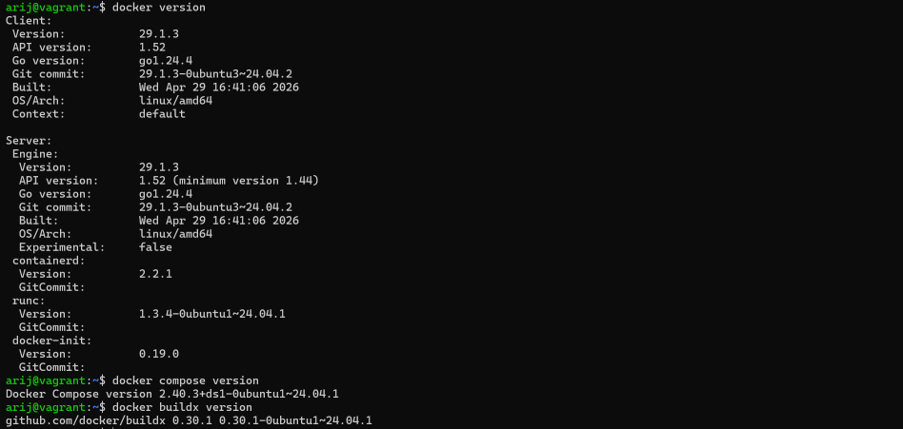

#### 2. Génération de package-lock.json
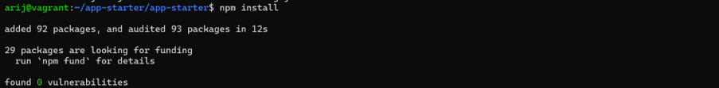

#### 3. Build de l'image naïve
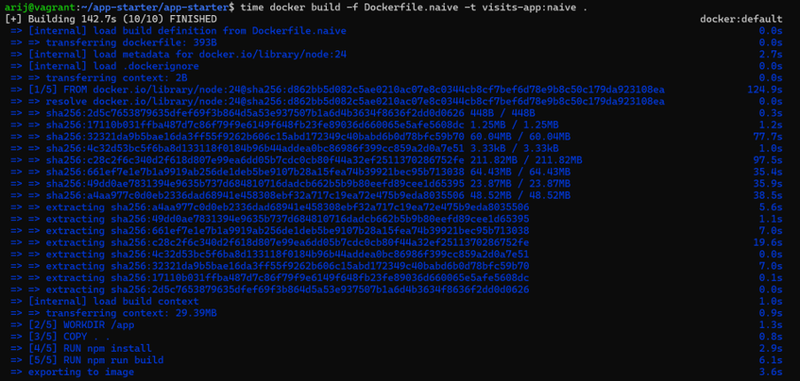

#### 4. Modification de src/server.ts
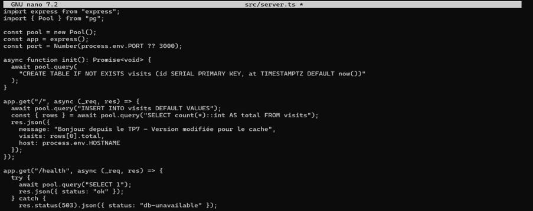

#### 5. Rebuild après modification (avec CACHED)
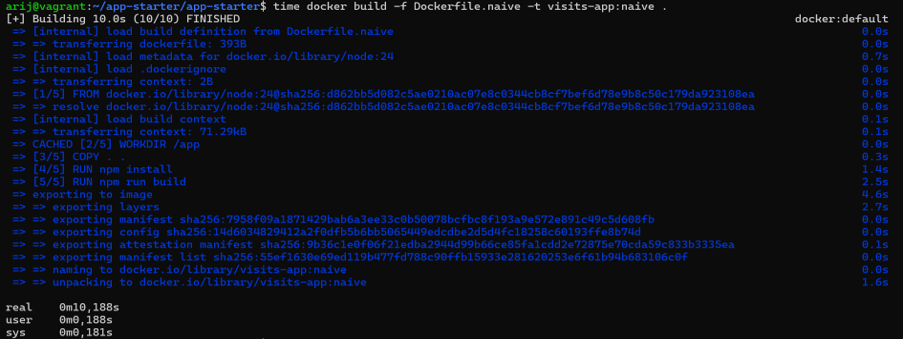

#### 6. Docker history (couches et tailles)
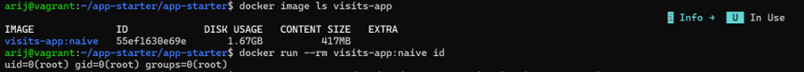

### 📊 Partie 2 : Mesurer l'image naïve

#### 7. Scan Trivy (vulnérabilités HIGH/CRITICAL)
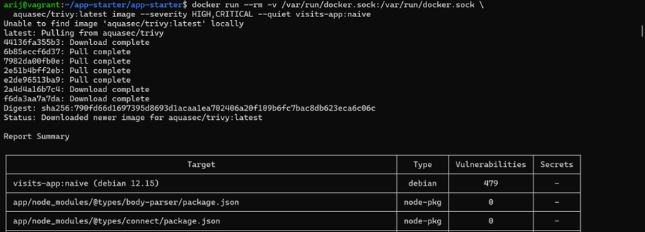
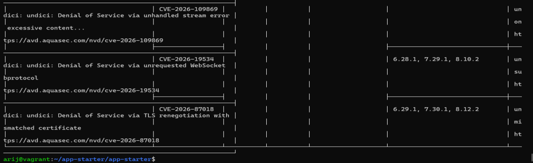

#### 8. Utilisateur root dans l'image naïve
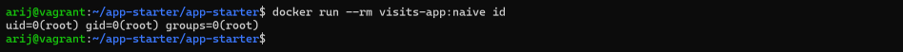

### 🏗️ Partie 3 : Dockerfile multi-stage

#### 9. Fichier .dockerignore
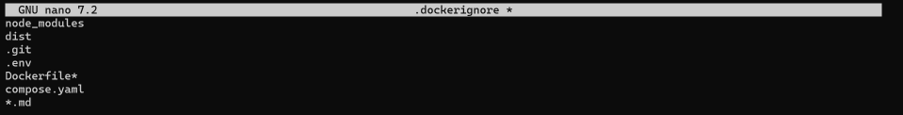

#### 10. Dockerfile multi-stage complété
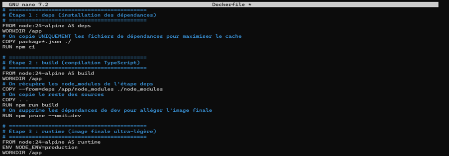

#### 11. Build de l'image multi-stage
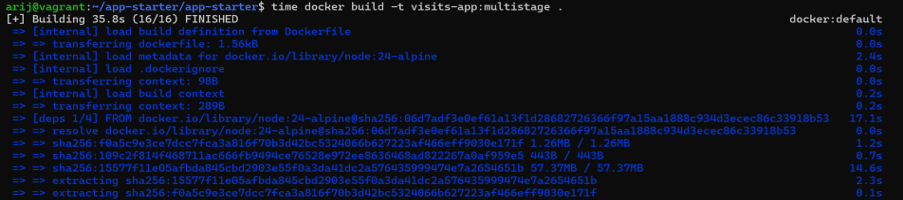

#### 12. Comparaison des tailles (naive vs multistage)
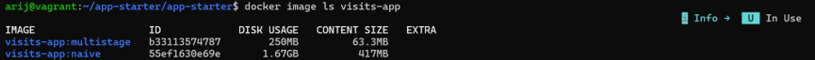

#### 13. Utilisateur non-root (node)
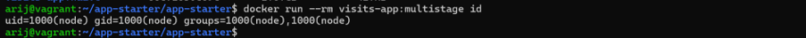

### 🐘 Partie 4 : Pile Docker Compose

#### 14. Fichier compose.yaml complété
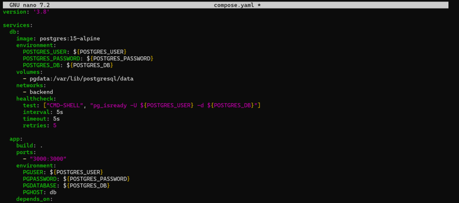

#### 15. Validation de la configuration
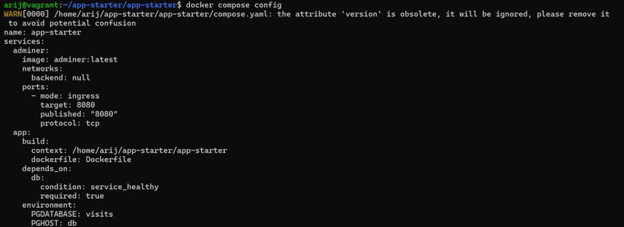

#### 16. Démarrage de la pile
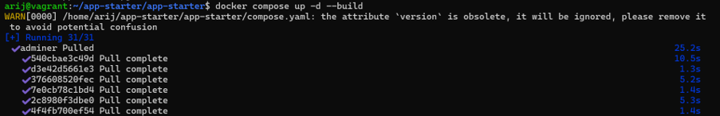
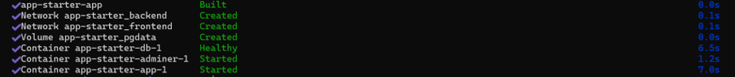

#### 17. État des conteneurs (db healthy)
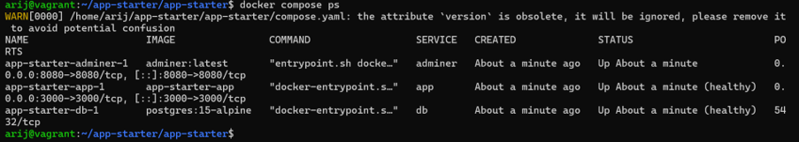

#### 18. Test de l'application (curl)
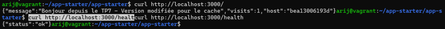

#### 19. Interface Adminer avec la table visits
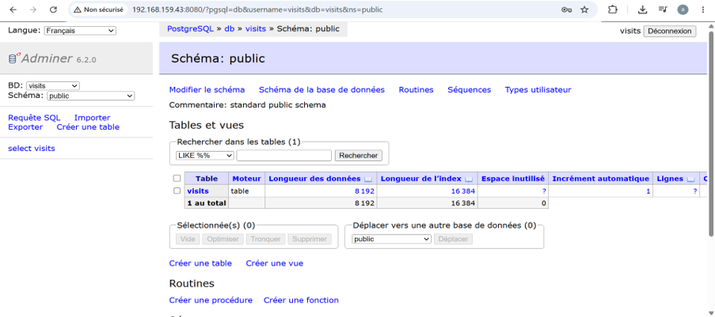

#### 20. Persistance du compteur (down/up)
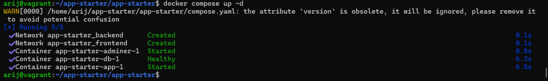

#### 21. Isolation réseau (psql -h localhost échoue)
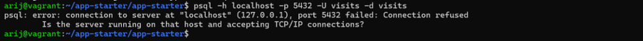

### 🚀 Partie 5 : Buildx et images multi-architecture

#### 22. Création du builder multiarch
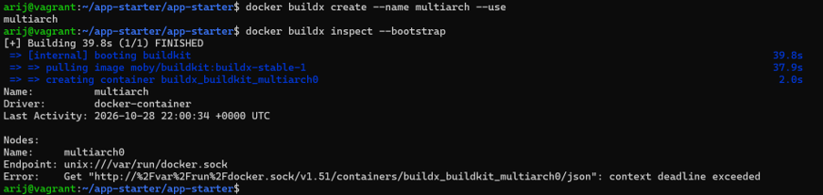

#### 23. Build multi-architecture (amd64 + arm64)
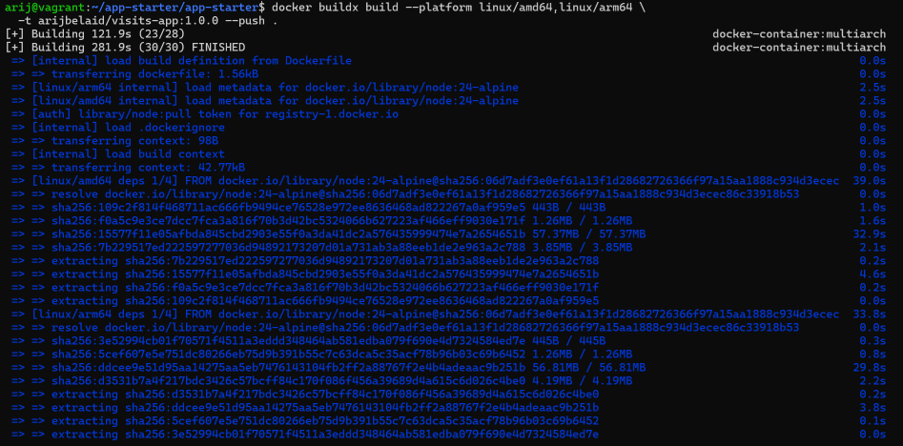

#### 24. Manifeste (amd64 et arm64)
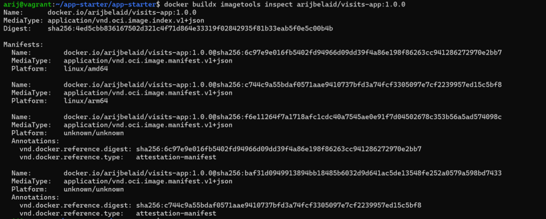

---

## 📊 Tableau comparatif

| Indicateur | naive | multistage |
| :--- | :--- | :--- |
| **Taille de l'image** | 1.67 GB | 250 MB |
| **Temps de build (à froid)** | ~142 s | ~35 s |
| **Temps de build (code modifié)** | ~10 s (npm install réexécuté) | ~5 s (cache npm ci) |
| **Vulnérabilités HIGH/CRITICAL** | 566 | 0 |
| **Utilisateur** | root (uid=0) | node (uid=1000) |

---

  <b>Fait avec ❤️ par Arij Belaid</b>

